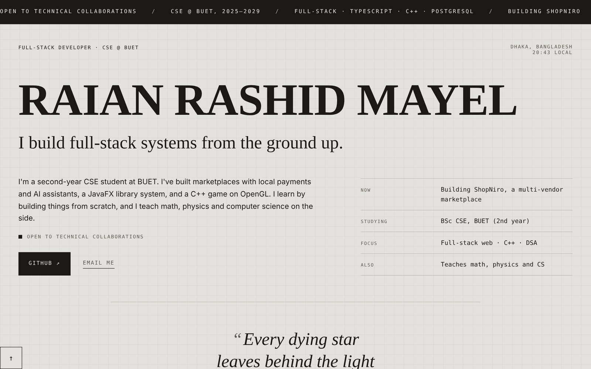
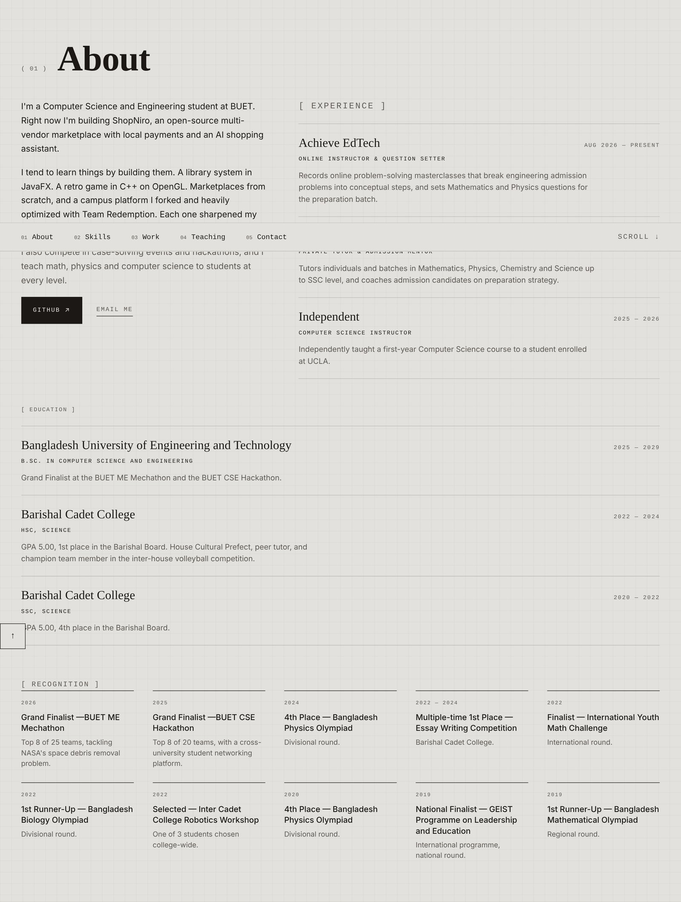
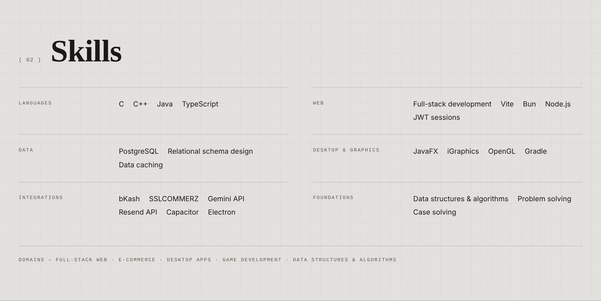
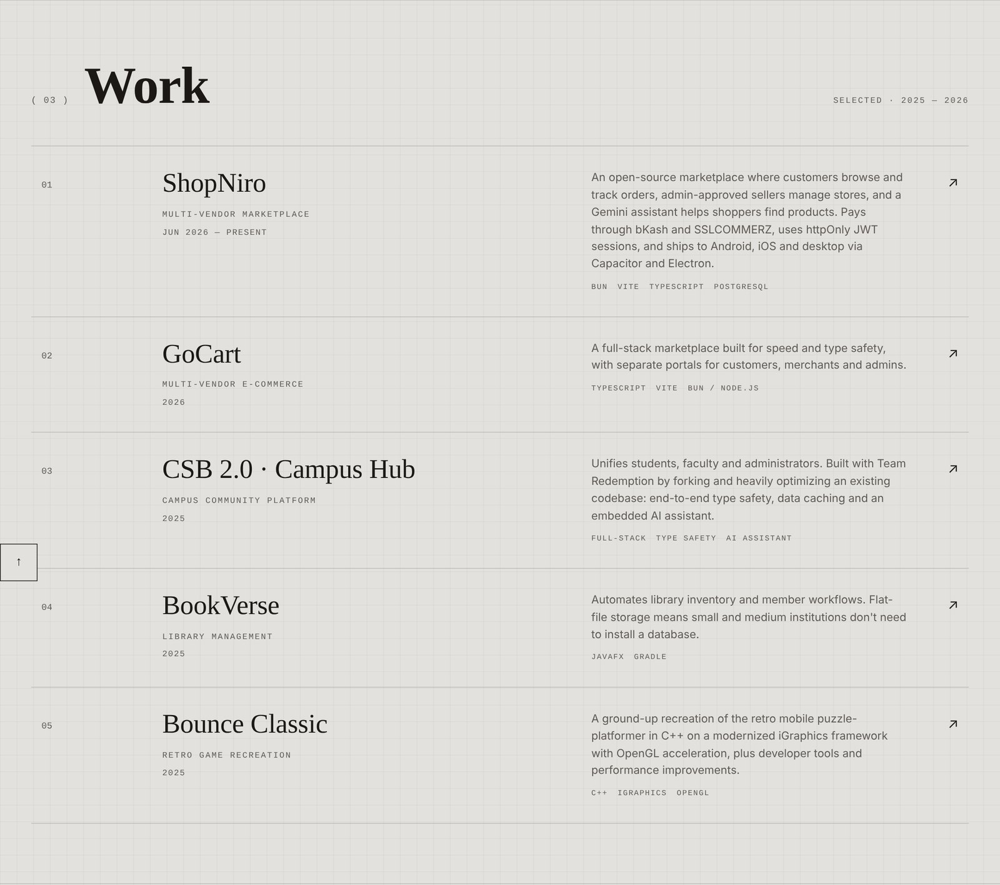
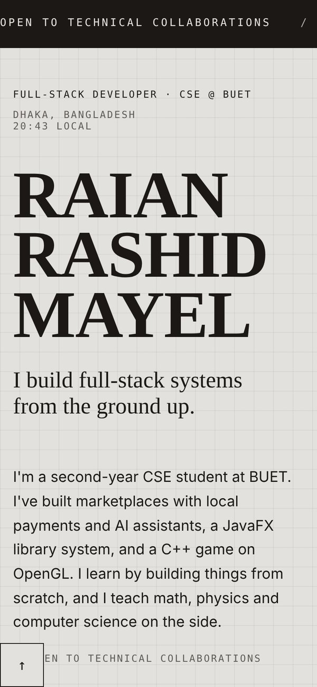
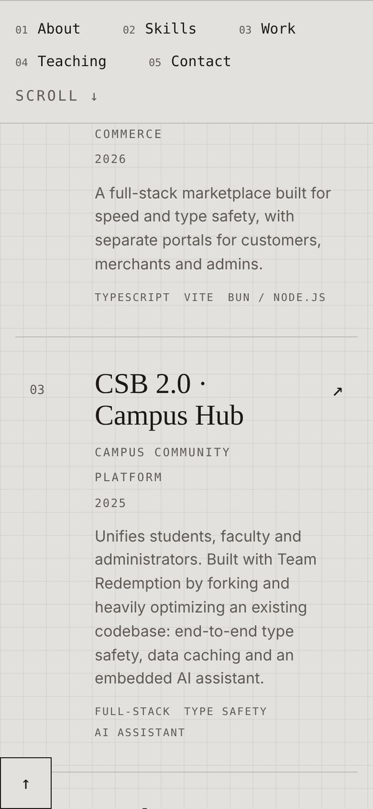
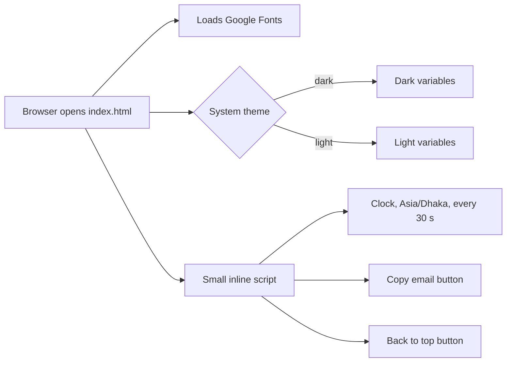

# Portfolio

**Raian Rashid Mayel: CSE student at BUET and full-stack developer.**

A single static page with no build step: a hero, an about section, skills,
selected work, teaching and contact, in light and dark.

[Screens](#screens) · [Sections](#sections) · [How it works](#how-it-works) · [Run locally](#run-locally) · [Deploy](#deploy-on-github-pages)

<picture>
<source media="(prefers-color-scheme: dark)" srcset="./.github/assets/readme/portfolio-hero.jpg" />

</picture>

## At a glance

| | |
| --- | --- |
| **What it is** | A one-page personal portfolio, all in `index.html` |
| **Sections** | About, Skills, Work, Teaching, Contact |
| **Work shown** | ShopNiro, GoCart, CSB 2.0, BookVerse and Bounce Classic, each linking to its repository |
| **Theme** | Follows the system light or dark setting through `prefers-color-scheme` |
| **Fonts** | Fraunces, Inter and JetBrains Mono from Google Fonts, with system fallbacks |
| **JavaScript** | A local-time clock for Dhaka, a copy-email button and a back-to-top button |
| **Dependencies** | None to install; open the file |

## Screens

These are real captures of `index.html` rendered in Chromium at 1440 px wide, in dark and light, taken from the file in this repository. The capture machine could not reach Google Fonts, so headings appear in the serif fallback rather than Fraunces.

<table>
<tr>
<td width="50%" valign="top">
<picture>
<source media="(prefers-color-scheme: dark)" srcset="./.github/assets/readme/portfolio-about.jpg" />

</picture>

<b>About.</b> Experience and education, laid out as a ruled list.

</td>
<td width="50%" valign="top">
<picture>
<source media="(prefers-color-scheme: dark)" srcset="./.github/assets/readme/portfolio-skills.jpg" />

</picture>

<b>Skills.</b> Six groups, from languages to integrations.

</td>
</tr>
<tr>
<td colspan="2" valign="top">
<picture>
<source media="(prefers-color-scheme: dark)" srcset="./.github/assets/readme/portfolio-work.jpg" />

</picture>

<b>Work.</b> Five projects, each row linking to its repository.

</td>
</tr>
</table>

### On a phone

Captured at 390 x 844. The section navigation wraps and the project rows stack.

<table>
<tr>
<td width="50%" valign="top">
<picture>
<source media="(prefers-color-scheme: dark)" srcset="./.github/assets/readme/portfolio-mobile-hero.jpg" />

</picture>

<b>Hero.</b>

</td>
<td width="50%" valign="top">
<picture>
<source media="(prefers-color-scheme: dark)" srcset="./.github/assets/readme/portfolio-mobile-work.jpg" />

</picture>

<b>Work.</b>

</td>
</tr>
</table>

## Sections

| # | Section | What is in it |
| --- | --- | --- |
| Hero | Name, tagline, introduction | Links to GitHub and to the email address, plus a facts list: now, studying, focus, also |
| 01 | About | Experience and education |
| 02 | Skills | Languages, web, data, desktop and graphics, integrations, foundations |
| 03 | Work | Five selected projects with a short description, stack tags and a link each |
| 04 | Teaching | Three-plus years of mentoring: mathematics, physics, chemistry, general science and computer science |
| 05 | Contact | Email with a copy button, GitHub and LinkedIn |

## How it works

All styling is in one `<style>` block and driven by CSS variables (`--bg`, `--ink`, `--muted`, `--rule`), so the dark theme is a second set of values for the same names. There is no framework and no build.

## Run locally

Open `index.html` in a browser.

## Deploy on GitHub Pages

1. Push this folder to a repository named `portfolio` (or `RM-81.github.io` for the root URL).
2. In the repository, go to Settings → Pages.
3. Set the source to the `main` branch and the `/ (root)` folder, then save.
4. The site goes live at `https://rm-81.github.io/portfolio/` within a minute or two.
